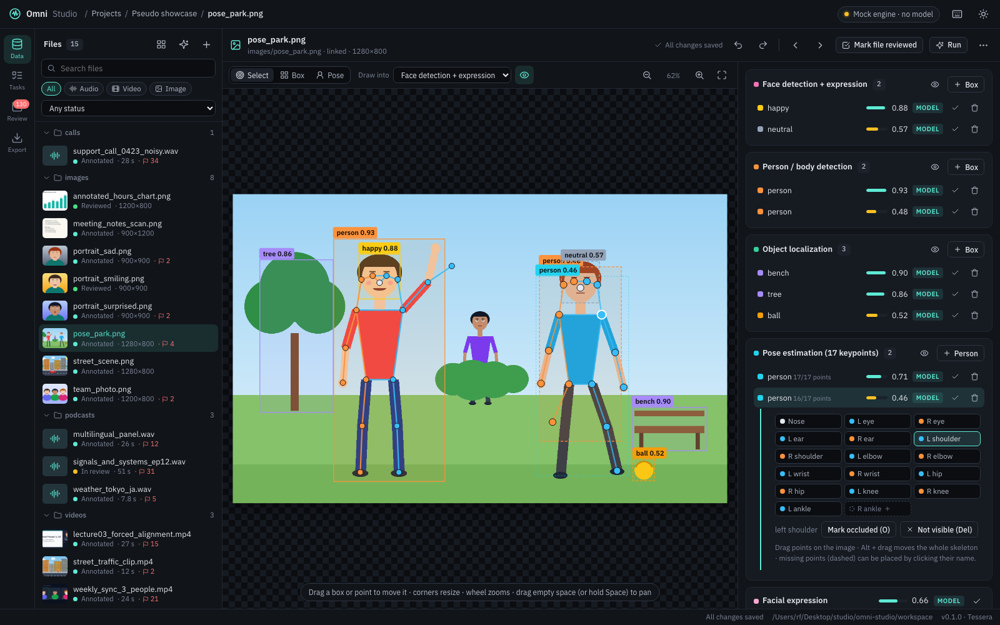
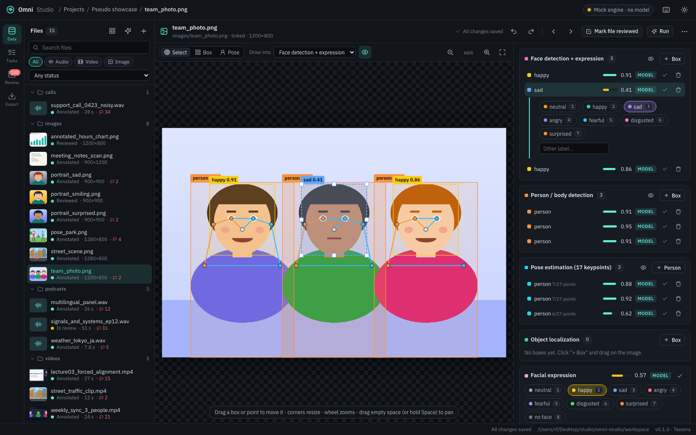

# Omni Studio

**Current release: v0.2.0 "Mosaic"** · see [CHANGELOG.md](CHANGELOG.md)


A local, multimodal annotation studio. Put audio, video and images (or whole mixed folders) into a
project, pick annotation and captioning tasks (or write your own as a prompt), apply them to every
file, then review and correct the results in an ELAN-style tier editor.

Version 0.1 is UI-first: **no model is connected yet**. A mock engine finds real speech regions
(energy VAD) and fills every tier with clearly-marked placeholder values, so the complete workflow
(run → review → correct → export) can be used and refined before Qwen3-Omni is plugged in.

## Run

```bash
./start.sh            # creates .venv on first run, then serves http://127.0.0.1:8710
```

Python 3.10+ is enough. Media decoding uses PyAV (bundled FFmpeg), so no system ffmpeg is needed.
Pseudo showcase project (synthetic speech from the macOS voices, generated videos and images, all tiers filled
with plausible pseudo labels):

```bash
.venv/bin/python scripts/make_pseudo.py
```

Optional demo project (links your local Conservatives_s1 recording with its real Qwen3-Omni output,
plus the ckpt50000 sample folder; nothing is copied):

```bash
.venv/bin/python scripts/make_demo.py
```

Environment variables: `OMNI_STUDIO_PORT` (8710), `OMNI_STUDIO_WORKSPACE` (./workspace),
`OMNI_NO_BROWSER=1` (don't open a browser tab).

## What you can do

| Area | Features |
| --- | --- |
| **Projects** | One folder per project with its data, task list and annotations. Coverage matrix (files × tasks), progress, low-confidence counter. |
| **Data** | Upload files or folders (drag & drop works, folder structure kept), or *link* a local folder so large datasets are not copied. Audio / video / image detected automatically. |
| **Tasks** | 44 built-in tasks (ASR, forced alignment, phonemes, diarization, pure speech, overlap, LID, SER, NER, quality, MOS, sound events, faces, people, objects, pose, OCR, spoof / deepfake, captioning…) grouped into annotation vs captioning. **Edit any task**: change its classes (chips or a plain list, double-click to rename) and its prompt; built-in tasks keep their output type and show their defaults. Changed and new tasks sit in their own column, separated by a vertical line, with **Reset to default** / **Delete**. **Test on a sample**: try a task, even unsaved edits, on 1–10 random files of the project without saving anything (listen to each result, shuffle, then run on all files). **New prompt task**: write an instruction, choose output (text / label / tags / score / boxes / keypoints) and granularity; the exact model prompt is previewed. Drag to reorder tiers. |
| **Run** | Apply the selected tasks to all / selected / un-annotated files in the background. Modes: fill empty tiers, re-run unreviewed tiers, or replace everything. |
| **Editor (audio & video)** | Waveform, spectrogram (linear/mel, colormaps) or both; video frame strip; overview + scrollbar; one lane per task with parent/child tiers (ASR → words → phones). Click to select, double-click / Enter to edit, drag on an empty lane to create, drag edges to adjust (snaps to other tiers), Alt-drag to move, split / merge, label hotkeys 1–9, undo/redo, autosave. Live transcript with word highlighting. |
| **Forced alignment on the signal** | Word (or phone) boundaries are drawn on the waveform and spectrogram with their labels, Praat-style. Every word has its own start and end: drag a border to move only that word (the highlighted one; on a shared border, the word on the side you grab). Its phones are rescaled with it and it stops at a touching neighbour. Hold **Alt**, or switch on **Linked**, to move the shared border of two touching words together. **Auto-play** (toolbar switch or `L`) replays the word after each change. Click a word to select it, double-click (or `P`) to listen. Choose the tier in the toolbar (**Boundaries**). The original model times stay in `meta.model_start / model_end`. |
| **Channel order** | Drag a tier header up or down (or use *Move up / down* in its menu). The order is saved on the project, so every file, the Tasks page, the coverage table and exports follow it. |
| **Editor (images)** | Image with editable regions plus one field per task (caption, labels, tags, score). **Boxes**: faces labelled with their expression, people / bodies, objects; select, move, resize with handles, relabel (1–9 or double-click), draw new ones (B), delete, nudge with the arrow keys. Boxes can stay unlabelled: new boxes start without a label (the picker offers "No label", Esc keeps it). **Pose**: COCO-17 skeletons; drag a keypoint, Alt-drag the whole skeleton, mark a point occluded (O) or not visible (Del), place a missing point by clicking its name then the image, add any extra point (P) and name it, connect two points with Shift + drag (or "connect to…"), click a connection and press Delete to remove it, add a new person (K). Zoom with the wheel, pan by dragging. Corrections keep the model output (`meta.model_geom`) and can be restored. |
| **Speakers & overlap** | **Speaker diarization** gives one segment per speaker turn, and turns may overlap. **Pure speech** marks where exactly one speaker talks (labelled with that speaker), **Overlap** where two or more talk at once (labelled with the pair, e.g. `SPEAKER_0 + SPEAKER_1`). When turns overlap, the Speaker tier shows one lane per speaker. After you correct the turns, *Rebuild from the speaker turns* (tier menu, or the prompt that appears) recomputes both tiers in one undo step. Export **Speaker clips**: every speaker's pure speech as WAV clips, one folder per speaker, plus the overlaps per pair and a `clips.csv`. |
| **Spoof & deepfake** | **Spoof (audio)**: bonafide or TTS / voice conversion / replay / spliced, per speech segment, so partly spoofed recordings are localized (also the audio of videos). **Deepfake (video)**: real or face swap / reenactment / lip-sync / fully generated, per 4-second window. **Spoof (image)**: real, AI-generated, face swap, edited or recaptured. **Fake regions**: boxes around manipulated parts of an image. Classes can be changed on the Tasks page like any other task. |
| **Statistics** | Files by type, length and status; where segments come from (model, people, derived) and how much is reviewed, per task. Label distributions per task by count or duration, text statistics (words, vocabulary, words per minute), score histograms, boxes / keypoints per image, the model's confidence. **How often reviewers kept or changed the model output**, with the most common corrections (e.g. `neutral → happy`) and how far boundaries were moved. Speaker figures: speech, pure speech and overlap time, overlap per speaker pair, files with the most overlap. Warnings for imbalanced or missing classes. Download as CSV. |
| **Share links** | **Share** (top bar) creates a link that opens one project in any browser, nothing to install. *View only* or *Can review & edit labels*, all tiers or only some, with or without downloads, optional expiry and a note. Links work on your network right away; **Internet** turns on a free Cloudflare quick tunnel (needs `cloudflared`). The owner app stays on this computer: shared links go through a separate listener (port 8711) that only allows that project, and edits made through a link are tagged with its name (`meta.edited_by`) and counted in Statistics. Turn a link off or delete it any time. |
| **Review** | Project-wide queue of the least-confident unreviewed segments; opens the file at that segment. `A` accepts and jumps to the next one. Edits keep the original model output (`meta.model_value`) for later evaluation. |
| **Import / export** | Import ELAN `.eaf`, Praat TextGrid (e.g. MFA output), the vLLM-omni pipeline JSON and native JSON. Export JSON, ELAN, TextGrid, SRT, WebVTT, RTTM, CSV, COCO JSON (boxes and keypoints), a JSONL training manifest (one line per utterance with all overlapping labels and word timings) and speaker clips (WAV). |

Press `?` in the app for all keyboard shortcuts.

## Screenshots

| | |
| --- | --- |
|  |  |
| Project dashboard with the file × task coverage table | Audio: waveform + spectrogram, one channel per task |
|  |  |
| Video: player, frame strip and tiers | Image: one field per task |
|  |  |
| Task library: annotation and captioning | Writing a new task as a prompt |
|  |  |
| Speakers, languages and translations | Review queue of low-confidence segments |
|  |  |
| Pose keypoints, person / face / object boxes | Fixing a face box and its expression label |

## Layout

```
backend/            FastAPI app (python -m backend)
  main.py           REST API + static frontend
  store.py          projects / media / annotations as plain JSON files
  media.py          probing, 16 kHz audio cache, waveform peaks, spectrogram + frame tiles
  tasks.py          task registry + prompt builder (instruction + structured-output spec)
  jobs.py           background runs, merging results into tiers
  formats.py        ELAN / TextGrid / JSON / SRT / VTT / RTTM / CSV / JSONL
  speakers.py       speaker turns -> pure speech per speaker + overlap per speaker pair
  stats.py          project statistics
  share.py          share links: records, the gate in front of the shared listener, Cloudflare tunnel
  engine/           annotation engines: base.py (interface), mock.py (placeholder)
config/tasks.json   built-in task library and presets (edit to add tasks)
frontend/           vanilla JS (ES modules, no build step) + CSS
scripts/make_demo.py
workspace/          your projects (git-ignored)
```

A project on disk:

```
workspace/projects/<id>/
  project.json            name, task ids (= tier order), settings
  media.json              files: modality, duration, size, linked path or uploaded copy
  media/...               uploaded files (folder structure preserved)
  annotations/<mid>.json  {"tiers": [...], "segments": [{tier_id, start, end, value, confidence, source, reviewed}]}
  cache/<mid>/            decoded audio, spectrogram, thumbnails (safe to delete)
```

## Connecting Qwen3-Omni later

Everything model-related goes through one method:

```python
class Engine:
    def annotate(self, task: dict, ctx: AnnotateContext) -> list[dict]:
        """Return [{"start", "end", "value", "confidence"}] for one task on one file."""
```

`ctx` provides the media item, its path, 16 kHz audio, the existing annotations and the results of
tasks that already ran on this file (so forced alignment can use the ASR output).
`tasks.build_prompt(task)` gives the full prompt including the JSON output instruction.
Add the new engine in `backend/engine/`, select it in `engine/__init__.py` (e.g. `OMNI_ENGINE=qwen_omni`),
and segments will be stored with `source: "model"` instead of `"mock"`.
