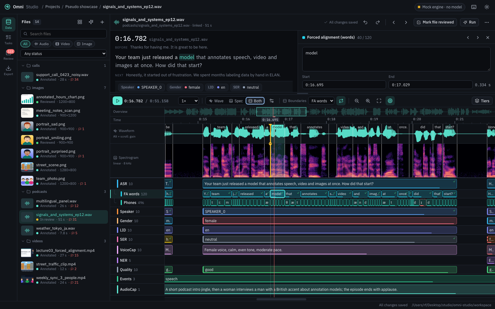
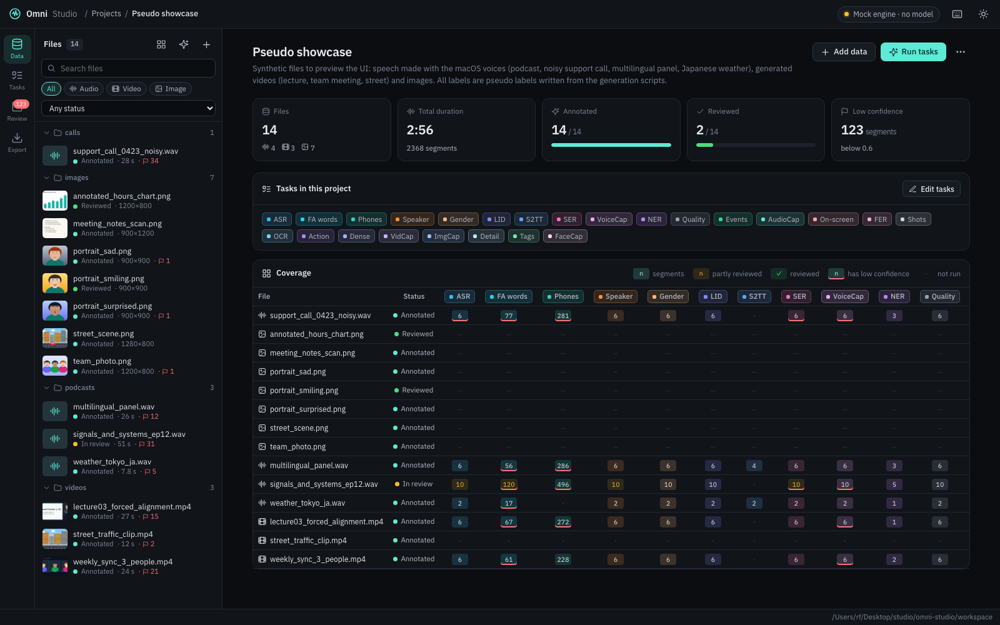
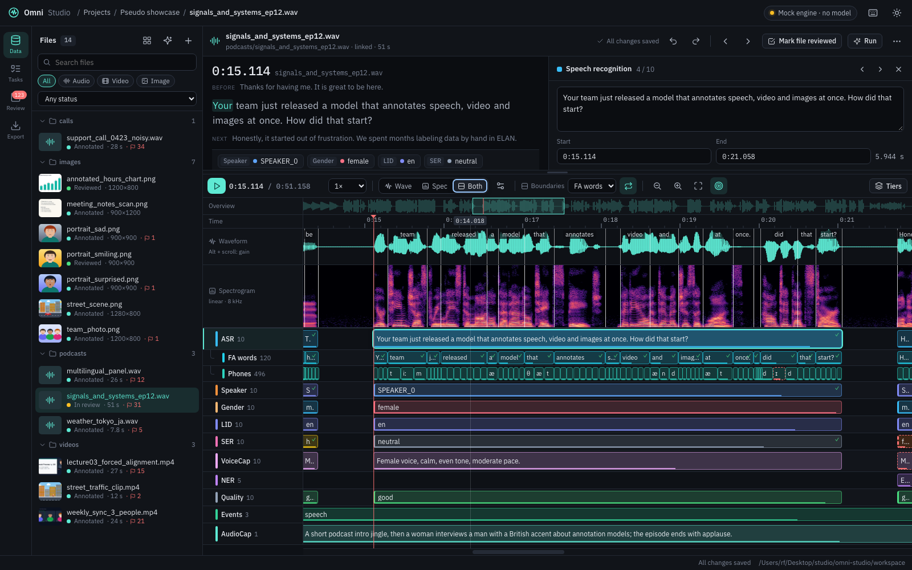
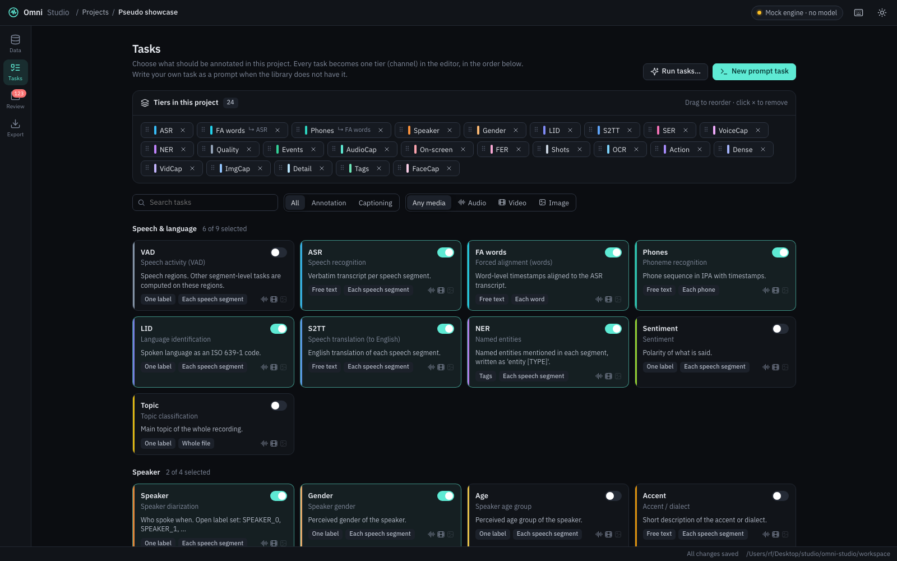
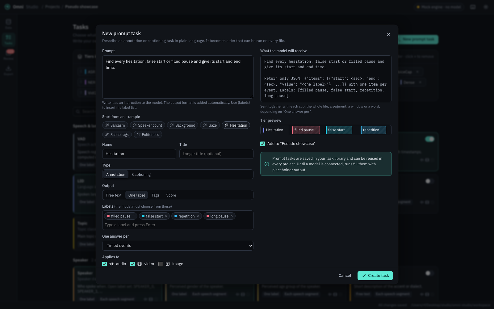
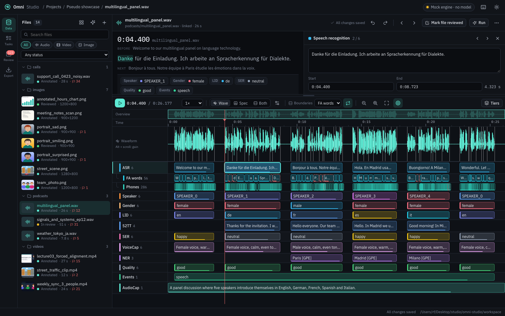
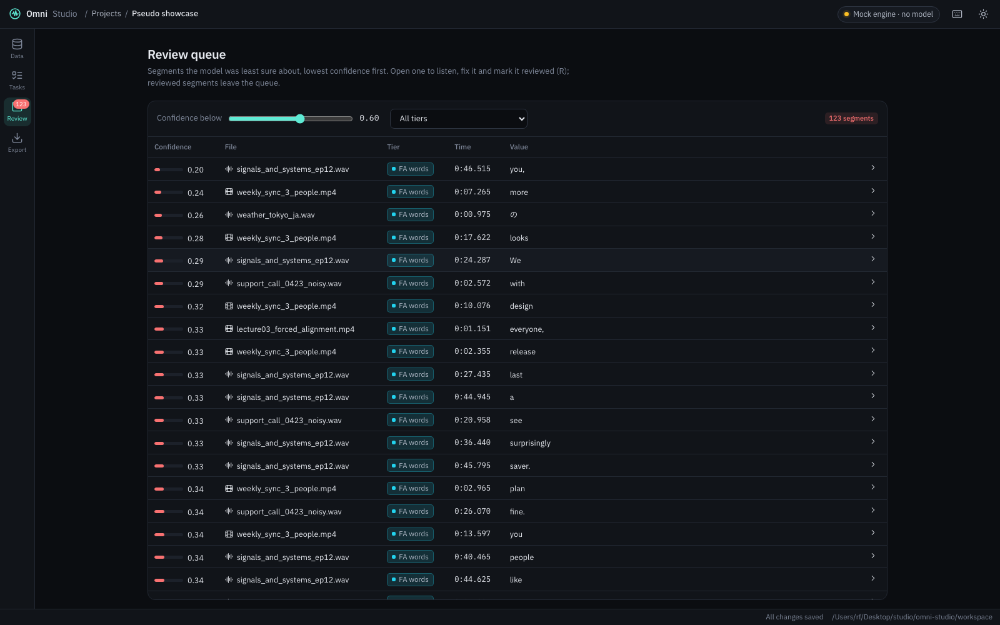

# Omni Studio

**Current release: v0.1.0 "Tessera"** · see [CHANGELOG.md](CHANGELOG.md)



A local, multimodal annotation studio. Put audio, video and images (or whole mixed folders) into a
project, pick annotation and captioning tasks (or write your own as a prompt), apply them to every
file, then review and correct the results in an ELAN-style tier editor.

Version 0.1 is UI-first: **no model is connected yet**. A mock engine finds real speech regions
(energy VAD) and fills every tier with clearly-marked placeholder values, so the complete workflow
(run → review → correct → export) can be used and refined before Qwen3-Omni is plugged in.

## Run

```bash
./start.sh            # creates .venv on first run, then serves http://127.0.0.1:8710
```

Python 3.10+ is enough. Media decoding uses PyAV (bundled FFmpeg), so no system ffmpeg is needed.
Pseudo showcase project (synthetic speech from the macOS voices, generated videos and images, all tiers filled
with plausible pseudo labels):

```bash
.venv/bin/python scripts/make_pseudo.py
```

Optional demo project (links your local Conservatives_s1 recording with its real Qwen3-Omni output,
plus the ckpt50000 sample folder; nothing is copied):

```bash
.venv/bin/python scripts/make_demo.py
```

Environment variables: `OMNI_STUDIO_PORT` (8710), `OMNI_STUDIO_WORKSPACE` (./workspace),
`OMNI_NO_BROWSER=1` (don't open a browser tab).

## What you can do

| Area | Features |
| --- | --- |
| **Projects** | One folder per project with its data, task list and annotations. Coverage matrix (files × tasks), progress, low-confidence counter. |
| **Data** | Upload files or folders (drag & drop works, folder structure kept), or *link* a local folder so large datasets are not copied. Audio / video / image detected automatically. |
| **Tasks** | 33 built-in tasks (ASR, forced alignment, phonemes, diarization, LID, SER, NER, quality, MOS, sound events, FER, AV emotion, OCR, captioning…) grouped into annotation vs captioning. **New prompt task**: write an instruction, choose output (text / label / tags / score) and granularity (whole file, per segment, windows, events, words, phones); the exact prompt the model will receive is previewed. Drag to reorder tiers. |
| **Run** | Apply the selected tasks to all / selected / un-annotated files in the background. Modes: fill empty tiers, re-run unreviewed tiers, or replace everything. |
| **Editor (audio & video)** | Waveform, spectrogram (linear/mel, colormaps) or both; video frame strip; overview + scrollbar; one lane per task with parent/child tiers (ASR → words → phones). Click to select, double-click / Enter to edit, drag on an empty lane to create, drag edges to adjust (snaps to other tiers), Alt-drag to move, split / merge, label hotkeys 1–9, undo/redo, autosave. Live transcript with word highlighting. |
| **Forced alignment on the signal** | Word (or phone) boundaries are drawn on the waveform and spectrogram with their labels, Praat-style. Drag a line to move it: the neighbouring word, the phones inside both words and a coinciding utterance edge follow, and the two words are played back on release. Click a word to select it, double-click (or `P`) to listen. Choose the tier in the toolbar (**Boundaries**). The original model times stay in `meta.model_start / model_end`. |
| **Channel order** | Drag a tier header up or down (or use *Move up / down* in its menu). The order is saved on the project, so every file, the Tasks page, the coverage table and exports follow it. |
| **Editor (images)** | Image viewer with one field per task (caption, labels, tags, score). |
| **Review** | Project-wide queue of the least-confident unreviewed segments; opens the file at that segment. `A` accepts and jumps to the next one. Edits keep the original model output (`meta.model_value`) for later evaluation. |
| **Import / export** | Import ELAN `.eaf`, Praat TextGrid (e.g. MFA output), the vLLM-omni pipeline JSON and native JSON. Export JSON, ELAN, TextGrid, SRT, WebVTT, RTTM, CSV and a JSONL training manifest (one line per utterance with all overlapping labels and word timings). |

Press `?` in the app for all keyboard shortcuts.

## Screenshots

| | |
| --- | --- |
|  |  |
| Project dashboard with the file × task coverage table | Audio: waveform + spectrogram, one channel per task |
|  |  |
| Video: player, frame strip and tiers | Image: one field per task |
|  |  |
| Task library: annotation and captioning | Writing a new task as a prompt |
|  |  |
| Speakers, languages and translations | Review queue of low-confidence segments |

## Layout

```
backend/            FastAPI app (python -m backend)
  main.py           REST API + static frontend
  store.py          projects / media / annotations as plain JSON files
  media.py          probing, 16 kHz audio cache, waveform peaks, spectrogram + frame tiles
  tasks.py          task registry + prompt builder (instruction + structured-output spec)
  jobs.py           background runs, merging results into tiers
  formats.py        ELAN / TextGrid / JSON / SRT / VTT / RTTM / CSV / JSONL
  engine/           annotation engines: base.py (interface), mock.py (placeholder)
config/tasks.json   built-in task library and presets (edit to add tasks)
frontend/           vanilla JS (ES modules, no build step) + CSS
scripts/make_demo.py
workspace/          your projects (git-ignored)
```

A project on disk:

```
workspace/projects/<id>/
  project.json            name, task ids (= tier order), settings
  media.json              files: modality, duration, size, linked path or uploaded copy
  media/...               uploaded files (folder structure preserved)
  annotations/<mid>.json  {"tiers": [...], "segments": [{tier_id, start, end, value, confidence, source, reviewed}]}
  cache/<mid>/            decoded audio, spectrogram, thumbnails (safe to delete)
```

## Connecting Qwen3-Omni later

Everything model-related goes through one method:

```python
class Engine:
    def annotate(self, task: dict, ctx: AnnotateContext) -> list[dict]:
        """Return [{"start", "end", "value", "confidence"}] for one task on one file."""
```

`ctx` provides the media item, its path, 16 kHz audio, the existing annotations and the results of
tasks that already ran on this file (so forced alignment can use the ASR output).
`tasks.build_prompt(task)` gives the full prompt including the JSON output instruction.
Add the new engine in `backend/engine/`, select it in `engine/__init__.py` (e.g. `OMNI_ENGINE=qwen_omni`),
and segments will be stored with `source: "model"` instead of `"mock"`.
