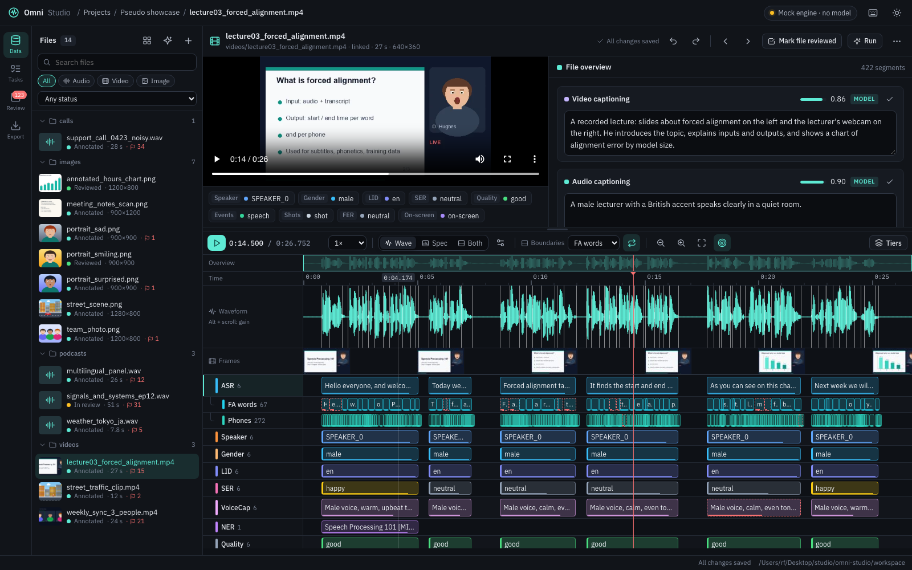
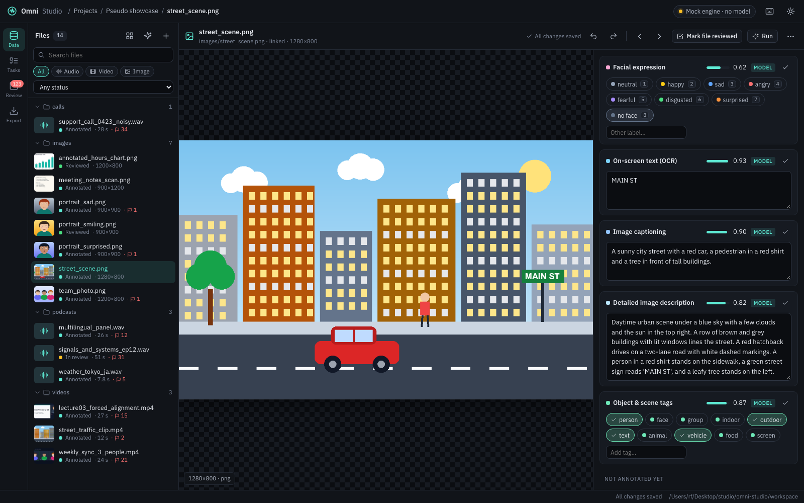

# Omni Studio

**Current release: v0.6.0 "Atelier"** · see [CHANGELOG.md](CHANGELOG.md)


A local, multimodal annotation studio. Put audio, video and images (or whole mixed folders) into a
project, pick annotation and captioning tasks (or write your own as a prompt), apply them to every
file, then review and correct the results in an ELAN-style tier editor.

Labels come from **RFomni**, the fine-tuned annotation model, served by vLLM-omni, plus small trained
heads on the same model for speakers, overlap, spoofing, pose and more (see *The model engine* below).
An **assistant** panel works next to you: it answers from the open project, points at the parts of the page
it talks about, writes task prompts and classes, and proposes every change on a card you approve.
Without a model server, `OMNI_ENGINE=mock` fills every tier with clearly-marked placeholder values.

## Run

```bash
./start.sh            # creates .venv on first run, then serves http://127.0.0.1:8710
```

Python 3.10+ is enough. Media decoding uses PyAV (bundled FFmpeg), so no system ffmpeg is needed.
Pseudo showcase project (synthetic speech from the macOS voices, or espeak-ng on Linux; generated videos and images,
all tiers filled with plausible pseudo labels):

```bash
.venv/bin/python scripts/make_pseudo.py
```

Optional demo project (links your local Conservatives_s1 recording with its real Qwen3-Omni output,
plus the ckpt50000 sample folder; nothing is copied):

```bash
.venv/bin/python scripts/make_demo.py
```

Environment variables: `OMNI_STUDIO_PORT` (8710), `OMNI_STUDIO_HOST` (127.0.0.1; 0.0.0.0 to serve your network),
`OMNI_STUDIO_SSL_CERT` / `OMNI_STUDIO_SSL_KEY` (https, needed for the microphone on other computers),
`OMNI_STUDIO_WORKSPACE` (./workspace), `OMNI_NO_BROWSER=1` (don't open a browser tab).
Model: `OMNI_ENGINE` (omni or mock), `OMNI_ENGINE_URL`, `OMNI_ENGINE_MODEL`, `OMNI_HEADS_URL`.
Sign-in: `OMNI_AUTH` (on; off = one local user, no sign-in), `OMNI_CHAT_URL` (the chat that owns the accounts),
`OMNI_FORWARD_JWT_SECRET` (shared with the chat, see *Sign-in*). Voice: `OMNI_VOICE_URL` (the voice agent).

## What you can do

| Area | Features |
| --- | --- |
| **Assistant** | A glass chat panel in the bottom-right corner (or `Ctrl+/`), also on the chat page as the *Omni Studio Assistant* model and by voice. It answers from the open project and page (chosen tasks by audio / video / image, what could be added, file counts), opens pages and **points at** the part it talks about with a ring and a note, filters the task library, and walks you through project → data → tasks → test → run → review. Every change (create a project, link data, add or remove tasks, write a task, test, run) is shown on an **approval card**; nothing happens until you approve, and **Stop** cancels a run. Each user has one plan shared by the panel, the chat page and voice; spoken approvals need the registered voice (speaker check). |
| **Task sharing (public page)** | `/tasks/` (*Task sharing* on the landing page): every live shared task its owner listed there, with search and a filter by kind of data. Anyone can open one and help, no account needed. *My shared tasks* leads to the owner's side below. Tasks can sort items into **groups** (e.g. languages): people choose one first, `{group}` in the wording becomes the chosen group, and *0 people per item* means everyone labels every item. `scripts/import_native_speaker.py` brings in the native-speaker labelling site (TidyVoiceX_Dev audio, `file_index.json`, earlier `results.json`). |
| **Data collection** | `/collect/` (*Data collection* on the landing page) lists live projects that ask people to record; *Data collection* in the studio's top bar is the owner's side. A project has sentences per language, ways to read them (e.g. emotions, each with an acting hint), instructions, a consent, optional questions about the speaker, and recording settings (16 or 48 kHz, shortest / longest length, how many recordings per sentence and way). People open `/c/<code>` (https, for the microphone), agree, get a session ID, choose a language and record each sentence in each way: raw microphone (no noise suppression, echo cancellation or gain), a waveform to listen to and trim (or *Trim silence*), record again, submit. The owner plays, accepts or rejects recordings, sees counts per language and way and the speakers, and exports a ZIP (audio/<language>/<way>/*.wav + metadata.csv). `scripts/make_emotion_collection.py` creates the sample *Multilingual emotional speech* project (en, de, fr, es, fa, zh; neutral, happy, sad, angry, surprised). |
| **Subjective tests** | `/listen/` (*Subjective test* on the landing page) lists live listening tests; *Subjective tests* in the studio's top bar is the owner's side (shared tasks of kind *listening*). People answer listener questions first (e.g. native speaker? device?), hear practice clips (not scored), may rate only after a clip has played to the end, never get the same sentence twice in a row, can go back and change an answer, and leave a closing comment; the page can be Persian, right to left. The owner adds the blind key (clip,system) privately and gets the MOS ± 95% interval per scale and per system, filtered by listener answers (e.g. native speakers only). `scripts/import_listening_test.py` brings in the Persian TTS test of QwenOmni-Talker (60 clips + 2 practice, naturalness / pronunciation / accent). |
| **Shared tasks** | *Shared tasks* in the top bar: data that needs human labels, shared as a link. Upload images, video, audio or text (.txt one item per line, .csv / .tsv with a text column, .jsonl), or add a server folder. Describe the task to the **design agent** and it writes the page: instructions, questions (one answer, several answers, a rating, free text), look and how many people label each item; the live preview changes at once, and everything can be edited by hand. **Go live** gives a link (on the network, or on the internet through the tunnel). People who open it need **no account**: they get a **session ID** (e.g. `K7Q2-M9XD`) to continue later on any device, and label one item at a time (keys 1–9 and Enter; works on phones). Results: progress, answer counts, agreement, people; export CSV (one row per answer) or JSONL (per item, with the majority answer). **Share a project for correction**: after the model has labelled a project, a link opens it in the full editor so people fix the labels; they get a session ID too, every change is signed with the link's name and their name or ID (`meta.edited_by`, `meta.edited_session`), and the page lists who changed how much. With downloads off there is no download button or save-as menu on the media, and the server refuses clips opened on their own and all exports (a browser can still record what it plays). |
| **Projects** | One folder per project with its data, task list and annotations. Coverage matrix (files × tasks), progress, low-confidence counter. |
| **Data** | Upload files or folders (drag & drop works, folder structure kept), or *link* a local folder so large datasets are not copied. Audio / video / image detected automatically. |
| **Tasks** | 48 built-in tasks (ASR, forced alignment, phonemes, diarization, pure speech, overlap, LID, SER, NER, quality, MOS, sound events, faces, people, objects, pose, OCR, spoof / deepfake, captioning…) grouped into annotation vs captioning. **Edit any task**: change its classes (chips or a plain list, double-click to rename) and its prompt; built-in tasks keep their output type and show their defaults. Changed and new tasks sit in their own column, separated by a vertical line, with **Reset to default** / **Delete**. **Test on a sample**: try a task, even unsaved edits, on 1–10 random files of the project without saving anything (listen to each result, shuffle, then run on all files). **New prompt task**: describe what you want and **Write it with AI** fills in a short prompt, clear classes, output and granularity (**Improve** refines it: "add a class for bored"), or write an instruction yourself, choose output (text / label / tags / score / boxes / keypoints) and granularity; the exact model prompt is previewed. Drag to reorder tiers. |
| **Run** | Apply the selected tasks to all / selected / un-annotated files in the background. Modes: fill empty tiers, re-run unreviewed tiers, or replace everything. |
| **Editor (audio & video)** | Waveform, spectrogram (linear/mel, colormaps) or both; video frame strip; overview + scrollbar; one lane per task with parent/child tiers (ASR → words → phones). Click to select, double-click / Enter to edit, drag on an empty lane to create, drag edges to adjust (snaps to other tiers), Alt-drag to move, split / merge, label hotkeys 1–9, undo/redo, autosave. Live transcript with word highlighting. |
| **Forced alignment on the signal** | Word (or phone) boundaries are drawn on the waveform and spectrogram with their labels, Praat-style. Every word has its own start and end: drag a border to move only that word (the highlighted one; on a shared border, the word on the side you grab). Its phones are rescaled with it and it stops at a touching neighbour. Hold **Alt**, or switch on **Linked**, to move the shared border of two touching words together. **Auto-play** (toolbar switch or `L`) replays the word after each change. Click a word to select it, double-click (or `P`) to listen. Choose the tier in the toolbar (**Boundaries**). The original model times stay in `meta.model_start / model_end`. |
| **Channel order** | Drag a tier header up or down (or use *Move up / down* in its menu). The order is saved on the project, so every file, the Tasks page, the coverage table and exports follow it. |
| **Editor (images)** | Image with editable regions plus one field per task (caption, labels, tags, score). **Boxes**: faces labelled with their expression, people / bodies, objects; select, move, resize with handles, relabel (1–9 or double-click), draw new ones (B), delete, nudge with the arrow keys. Boxes can stay unlabelled: new boxes start without a label (the picker offers "No label", Esc keeps it). **Pose**: COCO-17 skeletons; drag a keypoint, Alt-drag the whole skeleton, mark a point occluded (O) or not visible (Del), place a missing point by clicking its name then the image, add any extra point (P) and name it, connect two points with Shift + drag (or "connect to…"), click a connection and press Delete to remove it, add a new person (K). Zoom with the wheel, pan by dragging. Corrections keep the model output (`meta.model_geom`) and can be restored. |
| **Speakers & overlap** | **Speaker diarization** gives one segment per speaker turn, and turns may overlap. **Pure speech** marks where exactly one speaker talks (labelled with that speaker), **Overlap** where two or more talk at once (labelled with the pair, e.g. `SPEAKER_0 + SPEAKER_1`). When turns overlap, the Speaker tier shows one lane per speaker. After you correct the turns, *Rebuild from the speaker turns* (tier menu, or the prompt that appears) recomputes both tiers in one undo step. Export **Speaker clips**: every speaker's pure speech as WAV clips, one folder per speaker, plus the overlaps per pair and a `clips.csv`. |
| **Spoof & deepfake** | **Spoof (audio)**: bonafide or TTS / voice conversion / replay / spliced, per speech segment, so partly spoofed recordings are localized (also the audio of videos). **Deepfake (video)**: real or face swap / reenactment / lip-sync / fully generated, per 4-second window. **Spoof (image)**: real, AI-generated, face swap, edited or recaptured. **Fake regions**: boxes around manipulated parts of an image. Classes can be changed on the Tasks page like any other task. |
| **Statistics** | Files by type, length and status; where segments come from (model, people, derived) and how much is reviewed, per task. Label distributions per task by count or duration, text statistics (words, vocabulary, words per minute), score histograms, boxes / keypoints per image, the model's confidence. **How often reviewers kept or changed the model output**, with the most common corrections (e.g. `neutral → happy`) and how far boundaries were moved. Speaker figures: speech, pure speech and overlap time, overlap per speaker pair, files with the most overlap. Warnings for imbalanced or missing classes. Download as CSV. |
| **Share links** | **Share** (top bar) creates a link that opens one project in any browser, nothing to install. *View only* or *Can review & edit labels*, all tiers or only some, with or without downloads, optional expiry and a note. Links work on your network right away; **Internet** turns on a free Cloudflare quick tunnel (needs `cloudflared`). The owner app stays on this computer: shared links go through a separate listener (port 8711) that only allows that project, and edits made through a link are tagged with its name (`meta.edited_by`) and counted in Statistics. Turn a link off or delete it any time. |
| **Themes** | Day, Night and Green (the Forest palette: deep greens with a sage accent), chosen from the theme button in the top bar and remembered per browser; the landing page has the same switch and shares the choice. All colours come from theme tokens in `frontend/css/app.css`; Forest meets WCAG AA contrast for text, buttons and input borders. |
| **Review** | Project-wide queue of the least-confident unreviewed segments; opens the file at that segment. `A` accepts and jumps to the next one. Edits keep the original model output (`meta.model_value`) for later evaluation. |
| **Import / export** | Import ELAN `.eaf`, Praat TextGrid (e.g. MFA output), the vLLM-omni pipeline JSON and native JSON. Export JSON, ELAN, TextGrid, SRT, WebVTT, RTTM, CSV, COCO JSON (boxes and keypoints), a JSONL training manifest (one line per utterance with all overlapping labels and word timings) and speaker clips (WAV). |

Press `?` in the app for all keyboard shortcuts.

## Screenshots

| | |
| --- | --- |
|  |  |
| Project dashboard with the file × task coverage table | Audio: waveform + spectrogram, one channel per task |
|  |  |
| Video: player, frame strip and tiers | Image: one field per task |
|  |  |
| Task library: annotation and captioning | Writing a new task as a prompt |
|  |  |
| Speakers, languages and translations | Review queue of low-confidence segments |
|  |  |
| Pose keypoints, person / face / object boxes | Fixing a face box and its expression label |

## Landing page

`http://127.0.0.1:8710/landing/` (or *About* in the studio's top bar, on every page) is a one-page overview
of the studio for new users, served by the same local server: no hosting, no external requests.
Its *Open the studio* and *Sign in* buttons go through the sign-in page (`/login/`), which then takes you back to the page
you last had open in the studio.
At the top, a turning sphere of light grains with "AI" inside parts around the cursor (`frontend/landing/orb.js`);
below it a live feed of labels, and a paragraph whose words light up as you scroll.
In the Features section, all 44 tasks drop into a box as pills you can grab and throw (`frontend/landing/pile.js`).
The Your own tasks section shows writing a task as a prompt: a prompt box that writes example prompts, and nine agents at work (`frontend/landing/ask.js`).
The footer (links, contact, version) sits on rolling contour lines that drift towards you (`frontend/landing/terrain.js`).
Its main font, Satoshi, is free but may not be redistributed, so `start.sh` downloads your own copy from Fontshare
(`scripts/get_fonts.py`); without it the page uses the system font.

## Sign-in page

`/login/` is a frosted glass card over drifting lights, with the landing page's orb as the light
source (`frontend/login/`). It has *Sign in* and *Create an account* views, a password show/hide toggle and Google /
GitHub buttons marked *coming soon*.

**Accounts belong to the chat (Open WebUI)** (`backend/auth.py`). The studio posts the fields to the chat's sign-in and
keeps its session in the same `token` cookie, so with both apps on one address, signing in to either signs you in to both.
The app page and the API need a signed-in user; new accounts wait for an administrator's approval, and browsing the
server's folders, linking local data and the internet tunnel are for administrators. The chat sends its user to the
assistant as a signed header (`FORWARD_USER_INFO_HEADER_JWT_SECRET` on the chat = `OMNI_FORWARD_JWT_SECRET` here), and a
voice session carries a pass the studio signs, so the assistant's plan follows the person everywhere.

The card has a *Continue to* switch for the two apps: **Studio** (this app) and **Chat** (the agent chat, Open WebUI on
port 8080 of the same address; set in `CHAT_URL` at the top of `login.js`). The landing header's *Omni Studio* and *Chat*
links open `/login/?next=studio` and `/login/?next=chat`; *Task sharing*, *Subjective test* and *Data
collection* are shown as *Soon* until those parts exist.

## Layout

```
backend/            FastAPI app (python -m backend)
  main.py           REST API + static frontend
  store.py          projects / media / annotations as plain JSON files
  media.py          probing, 16 kHz audio cache, waveform peaks, spectrogram + frame tiles
  tasks.py          task registry + prompt builder (instruction + structured-output spec)
  jobs.py           background runs, merging results into tiers
  formats.py        ELAN / TextGrid / JSON / SRT / VTT / RTTM / CSV / JSONL
  speakers.py       speaker turns -> pure speech per speaker + overlap per speaker pair
  stats.py          project statistics
  share.py          share links: records, the gate in front of the shared listener, Cloudflare tunnel
  shared_tasks.py   shared tasks: data, page design, sessions, handing out items, answers, results, exports
  collect.py        data collection: projects, sessions, recordings (checked WAV), review, ZIP export
  collect_routes.py its API: /api/collect (owner), /api/c/<token> and /c/<token> (people), /api/public/collect
  shared_routes.py  their API: /api/shared (owner), /api/t/<token> and /t/<token> (people, no account)
  auth.py           sign-in shared with the chat (Open WebUI accounts), signed passes for voice
  engine/           annotation engines: base.py (interface), omni.py (RFomni on vLLM-omni),
                    heads.py (the trained heads service), mock.py (placeholder)
  agent/            the assistant: brain.py (decide + answer), actions.py (what it can do, page parts it
                    points at), knowledge.py (studio and project facts), drafter.py (task writer),
                    plan.py (one plan per user), routes.py (API + OpenAI-style endpoint), voice.py (voice relay),
                    designer.py (designs a shared task's page from the owner's description)
config/tasks.json   built-in task library and presets (edit to add tasks)
frontend/           vanilla JS (ES modules, no build step) + CSS
scripts/make_demo.py
workspace/          your projects (git-ignored)
```

A project on disk:

```
workspace/projects/<id>/
  project.json            name, task ids (= tier order), settings
  media.json              files: modality, duration, size, linked path or uploaded copy
  media/...               uploaded files (folder structure preserved)
  annotations/<mid>.json  {"tiers": [...], "segments": [{tier_id, start, end, value, confidence, source, reviewed}]}
  cache/<mid>/            decoded audio, spectrogram, thumbnails (safe to delete)
```

## The model engine

Everything model-related goes through one method:

```python
class Engine:
    def annotate(self, task: dict, ctx: AnnotateContext) -> list[dict]:
        """Return [{"start", "end", "value", "confidence"}] for one task on one file."""
```

`ctx` provides the media item, its path, 16 kHz audio, the existing annotations and the results of
tasks that already ran on this file (so forced alignment can use the ASR output).
`tasks.build_prompt(task)` gives the full prompt including the JSON output instruction.
`engine/omni.py` sends trained tasks with their short trained prompt, every other task (and any edited one) as its
prompt plus output spec, and head tasks to the heads service; tasks nothing can answer yet are reported, not faked.
Another engine goes in `backend/engine/` and is selected in `engine/__init__.py` (`OMNI_ENGINE`).
